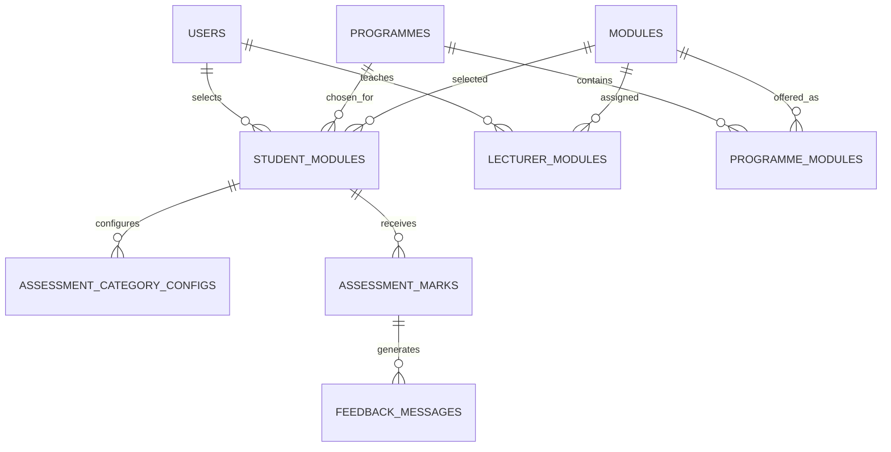

# SAASSP Database Schema

This document describes the SQLAlchemy schema and the data currently stored in the configured local database. The default database is `saassp.db` (SQLite); deployments can select another database through `DATABASE_URL`.

## Entity relationship diagram

`feedback_messages.mark_id` is a required foreign key. The ORM models feedback as a single object per mark, but the database does not have a unique constraint on `mark_id`, so the physical schema permits multiple feedback rows per mark.

## Tables

`PK` = primary key, `FK` = foreign key, `UQ` = unique constraint. Unless marked nullable, columns are required.

### `users`

| Column | Type | Constraints |
| --- | --- | --- |
| `id` | INTEGER | PK |
| `name` | VARCHAR(100) | |
| `student_number` | VARCHAR(20) | Nullable, unique |
| `email` | VARCHAR(100) | Nullable, unique |
| `role` | VARCHAR(20) | |
| `password_hash` | VARCHAR(255) | |

### `programmes`

| Column | Type | Constraints |
| --- | --- | --- |
| `programme_code` | VARCHAR(10) | PK |
| `programme_name` | VARCHAR(150) | |

### `modules`

| Column | Type | Constraints |
| --- | --- | --- |
| `module_code` | VARCHAR(10) | PK |
| `module_name` | VARCHAR(150) | |

### `programme_modules`

| Column | Type | Constraints |
| --- | --- | --- |
| `id` | INTEGER | PK |
| `programme_code` | VARCHAR(10) | FK -> `programmes.programme_code` |
| `module_code` | VARCHAR(10) | FK -> `modules.module_code` |

UQ: (`programme_code`, `module_code`).

### `lecturer_modules`

| Column | Type | Constraints |
| --- | --- | --- |
| `id` | INTEGER | PK |
| `lecturer_id` | INTEGER | FK -> `users.id` |
| `module_code` | VARCHAR(10) | FK -> `modules.module_code` |

UQ: (`lecturer_id`, `module_code`).

### `student_modules`

| Column | Type | Constraints |
| --- | --- | --- |
| `id` | INTEGER | PK |
| `student_id` | INTEGER | FK -> `users.id` |
| `programme_code` | VARCHAR(10) | FK -> `programmes.programme_code` |
| `module_code` | VARCHAR(10) | FK -> `modules.module_code` |

UQ: (`student_id`, `module_code`).

### `assessment_category_configs`

| Column | Type | Constraints |
| --- | --- | --- |
| `id` | INTEGER | PK |
| `student_module_id` | INTEGER | FK -> `student_modules.id` |
| `category_name` | VARCHAR(20) | |
| `dp_weighting` | INTEGER | Default 0 |
| `total_assessments` | INTEGER | Default 0 |
| `recorded_count` | INTEGER | Default 0 |

UQ: (`student_module_id`, `category_name`).

### `assessment_marks`

| Column | Type | Constraints |
| --- | --- | --- |
| `id` | INTEGER | PK |
| `student_module_id` | INTEGER | FK -> `student_modules.id` |
| `category_name` | VARCHAR(20) | |
| `percentage_achieved` | NUMERIC(5, 2) | |
| `date_uploaded` | DATETIME | Nullable, default current UTC time |
| `recorded_towards_dp` | BOOLEAN | Nullable, default false |
| `sequence` | INTEGER | Default 0 |

### `feedback_messages`

| Column | Type | Constraints |
| --- | --- | --- |
| `id` | INTEGER | PK |
| `mark_id` | INTEGER | FK -> `assessment_marks.id` |
| `dp_progress_percentage` | NUMERIC(5, 2) | Nullable |
| `threshold_band` | VARCHAR(30) | Nullable |
| `trend_classification` | VARCHAR(20) | Nullable |
| `generated_text` | TEXT | Nullable |
| `created_at` | DATETIME | Nullable, default current UTC time |

## Current data snapshot

Row counts read from the configured database on 2026-09-29. No personal account values or password hashes are included.

| Table | Rows |
| --- | ---: |
| `users` | 5 |
| `programmes` | 37 |
| `modules` | 120 |
| `programme_modules` | 1,042 |
| `lecturer_modules` | 1 |
| `student_modules` | 17 |
| `assessment_category_configs` | 15 |
| `assessment_marks` | 8 |
| `feedback_messages` | 8 |

User roles: 3 students, 1 academic staff account, and 1 administrator account.

The programme and module catalogues originate from `data/programmes.csv`, `data/modules.csv`, and `data/programme_modules.csv`. Database counts can differ from those source files if the catalogue has since been edited or reseeded.
